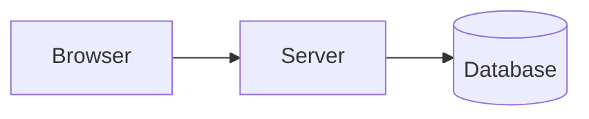

# Architecture: {{PROJECT_NAME}}

Describes the CURRENT system. Decisions and their reasons are in
[decisions/](decisions/README.md); changes over time in [history/](history/).
Nothing built yet? Say so here and link the proposed design (concept or
Proposed ADR) — see [DOCUMENTATION.md](DOCUMENTATION.md). The diagram
below is a placeholder, not a fact.

## 1. Overview

Components and how a request flows through them (diagram welcome).

## 2. Repository layout

| Path | Content |
|---|---|
| | |

## 3. Request flow and security

Authentication, sessions, roles, authorization checks, input validation.

## 4. Modules / services

## 5. Data model

## 6. Background behaviour

## 7. Deployment

See [DEPLOY.md](DEPLOY.md) for the procedure; here only the topology.

## 8. Failure behaviour

## 9. Testing

## 10. Constraints
